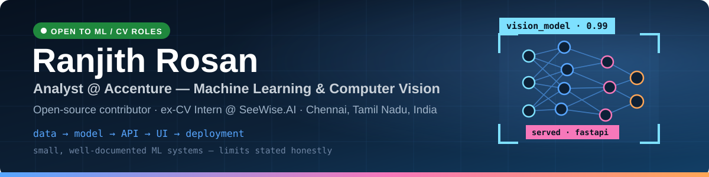

<!-- DYNAMIC:IMPACT_BADGES:START -->

  
  
  
  

<!-- DYNAMIC:IMPACT_BADGES:END -->

  
  
  

  <a href="#open-source">🌍 Open Source</a> &nbsp;·&nbsp;
  <a href="#projects">🚀 Projects</a> &nbsp;·&nbsp;
  <a href="#experience">💼 Experience</a> &nbsp;·&nbsp;
  <a href="#stats">📊 Stats</a> &nbsp;·&nbsp;
  <a href="#contact">📫 Contact</a>

---

I build small, well-documented ML systems end to end — data, model, API, UI, deployment — and contribute fixes to the open-source tools I use. Previously a **computer-vision intern at SeeWise.AI**, where I worked on industrial-safety detection (PPE, people, machinery). Lately my open-source work has widened from CV into **AI infrastructure (MCP servers), ML research code, and shader/compiler tooling**.

### 🔭 What I'm focused on now

- **Machine learning & computer vision** — object detection, auto-labelling, model cards and honest evaluation
- **AI infrastructure** — Model Context Protocol (MCP) servers for Kubeflow and GitHub workflows
- **Research & systems code** — maintenance fixes in large, unfamiliar codebases (ML research, shader transpilers, developer tools)
- **Building in public** — every project below ships with docs, tests or a live demo, and states its limits clearly

---

## 🌍 Open-source contributions — by company / organisation

<!-- DYNAMIC:OSS_SUMMARY:START -->
> **95 pull requests to 53 external projects** · [**22 merged upstream**](https://github.com/search?q=type%3Apr%20author%3ARANJITHROSAN17%20is%3Amerged%20-user%3ARANJITHROSAN17&type=pullrequests) · [**33 in review right now**](https://github.com/search?q=type%3Apr%20author%3ARANJITHROSAN17%20is%3Aopen%20-user%3ARANJITHROSAN17&type=pullrequests) · auto-updated 26 Oct 2026 - every number below links to a live search you can verify.
>
> Status key: 🟣 **Merged** = merged upstream &nbsp;·&nbsp; 🟢 **In review** = open PR, not yet merged - I don't claim orgs I haven't landed in (yet).
<!-- DYNAMIC:OSS_SUMMARY:END -->

<!-- DYNAMIC:OSS_SNAPSHOT:START -->
**🟣 Merged upstream in:** [CrossGL](https://github.com/CrossGL/crosstl) · [Ultralytics](https://github.com/ultralytics/yolov3) · [Amazon Web Services](https://github.com/aws-samples/step-functions-workflows-collection) · [Opencollab MCP](https://github.com/prakhar1605/Opencollab-mcp) · [Golang Cafe](https://github.com/golang-cafe/job-board) · +6 earlier in smaller projects

**🟢 Currently in review at:** [Google Research](https://github.com/google-research/google-research) · [Microsoft](https://github.com/microsoft/vscode) · [OpenAI](https://github.com/openai/openai-cookbook) · [NSA - Ghidra](https://github.com/NationalSecurityAgency/ghidra) · [Kubeflow](https://github.com/kubeflow/mcp-server) · [Nous Research](https://github.com/NousResearch/hermes-agent) · [Costura AI](https://github.com/CosturaAI/costura)
<!-- DYNAMIC:OSS_SNAPSHOT:END -->

<!-- DYNAMIC:OSS_TABLE:START -->
| Organisation | Project | What my PRs touch | 🟣 Merged | 🟢 In review | Latest PR |
|---|---|---|---:|---:|---|
|  **Google Research** | [google-research/google-research](https://github.com/google-research/google-research) (★39k) | ML research maintenance - snerg Flax->Optax migration, uflow multi-dataset training, summae & distributed_shampoo fixes | · | 15 | 🟢 [#3465](https://github.com/google-research/google-research/pull/3465) |
|  **Microsoft** | [microsoft/vscode](https://github.com/microsoft/vscode) (★194k) | VS Code Git extension safety - literal-pathspec discard, scp-like clone folder names | · | 2 | 🟢 [#344032](https://github.com/microsoft/vscode/pull/344032) |
|  **OpenAI** | [openai/openai-cookbook](https://github.com/openai/openai-cookbook) (★77k) | Data-analyst cookbook - schema-scoped table-context lookups | · | 1 | 🟢 [#3239](https://github.com/openai/openai-cookbook/pull/3239) |
|  **NSA - Ghidra** | [NationalSecurityAgency/ghidra](https://github.com/NationalSecurityAgency/ghidra) (★95k) | Reverse-engineering framework - AVR8 12-bit PC variant, PackedDatabase unpack hardening, .eh_frame analysis | · | 2 | 🟢 [#10021](https://github.com/NationalSecurityAgency/ghidra/pull/10021) |
|  **CrossGL** | [CrossGL/crosstl](https://github.com/CrossGL/crosstl) (★1.5k) | Shader transpiler (GLSL/HLSL/Metal/SPIR-V/Slang/WGSL) - backend lowering, resource binding & provenance, conformance harness | 10 | · | 🟣 [#3050](https://github.com/CrossGL/crosstl/pull/3050) |
|  **Kubeflow** | [kubeflow/mcp-server](https://github.com/kubeflow/mcp-server) (★55) | MCP server for Kubeflow Trainer - rate-limit/circuit-breaker & RED metrics, schedulable-GPU counting, training lifecycle fixes | · | 8 | 🟢 [#487](https://github.com/kubeflow/mcp-server/pull/487) |
|  **Nous Research** | [NousResearch/hermes-agent](https://github.com/NousResearch/hermes-agent) (★257k) | Hermes Agent - plugin Settings config_source, managed-worker job scoping, desktop typecheck heap | · | 3 | 🟢 [#144554](https://github.com/NousResearch/hermes-agent/pull/144554) |
|  **Ultralytics** | [ultralytics/yolov3](https://github.com/ultralytics/yolov3) (★11k) | YOLOv3 object detection - requirements fix | 1 | · | 🟣 [#2333](https://github.com/ultralytics/yolov3/pull/2333) |
|  **Amazon Web Services** | [aws-samples/step-functions-workflows-collection](https://github.com/aws-samples/step-functions-workflows-collection) (★281) | AWS Step Functions workflow collection - template update | 1 | · | 🟣 [#283](https://github.com/aws-samples/step-functions-workflows-collection/pull/283) |
|  **Opencollab MCP** | [prakhar1605/Opencollab-mcp](https://github.com/prakhar1605/Opencollab-mcp) (★35) | Contribution-matchmaking MCP - shared GitHub paginator, closing-PR vs. plain-mention detection | 2 | · | 🟣 [#216](https://github.com/prakhar1605/Opencollab-mcp/pull/216) |
|  **Costura AI** | [CosturaAI/costura](https://github.com/CosturaAI/costura) (★4) | AI spend attribution - invalid snooze-input test coverage | · | 1 | 🟢 [#20](https://github.com/CosturaAI/costura/pull/20) |
|  **Golang Cafe** | [golang-cafe/job-board](https://github.com/golang-cafe/job-board) (★228) | Go job board - golangci-lint workflow updates | 2 | · | 🟣 [#121](https://github.com/golang-cafe/job-board/pull/121) |

Plus 6 earlier merged PRs in smaller projects - [see every upstream-merged PR](https://github.com/search?q=type%3Apr%20author%3ARANJITHROSAN17%20is%3Amerged%20-user%3ARANJITHROSAN17&type=pullrequests).
<!-- DYNAMIC:OSS_TABLE:END -->

<!-- DYNAMIC:OSS_DETAILS:START -->

<strong>📂 Expand — every featured PR, grouped by organisation (auto-updated)</strong>

####  Google Research — [google-research/google-research](https://github.com/google-research/google-research) · 0 merged · 15 in review

- 🟢 In review · 2026-10-24 · [snerg: replace the removed flax.optim API with Optax](https://github.com/google-research/google-research/pull/3465)
- 🟢 In review · 2026-10-24 · [uflow: train on every dataset listed in train_on, not just the first](https://github.com/google-research/google-research/pull/3464)
- 🟢 In review · 2026-10-24 · [summae: stop doubling the residual stream in the decoder FFN block](https://github.com/google-research/google-research/pull/3463)
- 🟢 In review · 2026-10-24 · [distributed_shampoo: drop the overwritten inverse-pth-root computation](https://github.com/google-research/google-research/pull/3462)
- 🟢 In review · 2026-10-24 · [misinfo_provenance: remove duplicated flag definition and fix misspelling](https://github.com/google-research/google-research/pull/3461)
- 🟢 In review · 2026-10-24 · [fvlm: give the package directories a real __init__.py](https://github.com/google-research/google-research/pull/3460)
- 🟢 In review · 2026-10-24 · [vrdu: report -1 for entity names with no groundtruth instead of a free recall](https://github.com/google-research/google-research/pull/3459)
- 🟢 In review · 2026-10-24 · [instruction_following_eval: pass the prompt to checkers that require it](https://github.com/google-research/google-research/pull/3458)
- 🟢 In review · 2026-10-24 · [Shampoo: stop mutating gradients and momentum buffers during step](https://github.com/google-research/google-research/pull/3457)
- 🟢 In review · 2026-10-24 · [sifer: remove call to non-existent misc.download_files](https://github.com/google-research/google-research/pull/3456)
- 🟢 In review · 2026-10-24 · [task_set: validate sample_log_float bounds and fix reversed call sites](https://github.com/google-research/google-research/pull/3455)
- 🟢 In review · 2026-10-24 · [instruction_following_eval: make letter-frequency and language checks reproducible](https://github.com/google-research/google-research/pull/3454)
- 🟢 In review · 2026-10-24 · [trimap: run input rescaling when PCA is skipped, not when verbose is off](https://github.com/google-research/google-research/pull/3453)
- 🟢 In review · 2026-10-24 · [rouge: pair target and prediction files by example id, not by sort position](https://github.com/google-research/google-research/pull/3452)
- 🟢 In review · 2026-10-24 · [scalable_shampoo: use Tensor.device for state allocation so CPU parameters work](https://github.com/google-research/google-research/pull/3451)

####  Microsoft — [microsoft/vscode](https://github.com/microsoft/vscode) · 0 merged · 2 in review

- 🟢 In review · 2026-10-24 · [git: discard files by literal pathspec so a file named `*` cannot wipe the rest](https://github.com/microsoft/vscode/pull/344032)
- 🟢 In review · 2026-10-24 · [git: derive the clone folder name from scp-like URLs](https://github.com/microsoft/vscode/pull/344033)

####  OpenAI — [openai/openai-cookbook](https://github.com/openai/openai-cookbook) · 0 merged · 1 in review

- 🟢 In review · 2026-10-25 · [Scope data analyst table context lookups by schema](https://github.com/openai/openai-cookbook/pull/3239)

####  NSA - Ghidra — [NationalSecurityAgency/ghidra](https://github.com/NationalSecurityAgency/ghidra) · 0 merged · 2 in review

- 🟢 In review · 2026-10-26 · [AVR8: add a language variant for devices with a 12-bit wrapping PC](https://github.com/NationalSecurityAgency/ghidra/pull/10021)
- 🟢 In review · 2026-10-26 · [Create functions at .eh_frame FDE starts that are not .cold pieces](https://github.com/NationalSecurityAgency/ghidra/pull/10019)

####  CrossGL — [CrossGL/crosstl](https://github.com/CrossGL/crosstl) · 10 merged · 0 in review

- 🟣 Merged · 2026-10-26 · [Refuse HLSL dx::MaybeReorderThread for targets other than Direct3D](https://github.com/CrossGL/crosstl/pull/3050)
- 🟣 Merged · 2026-10-25 · [Keep integer min and max integer in CUDA and HIP output](https://github.com/CrossGL/crosstl/pull/3067)
- 🟣 Merged · 2026-10-25 · [Preserve resource provenance for pointer-bearing aggregate members](https://github.com/CrossGL/crosstl/pull/3046)
- 🟣 Merged · 2026-10-25 · [Wrap 8- and 16-bit scalar integer arithmetic in GLSL](https://github.com/CrossGL/crosstl/pull/3041)
- 🟣 Merged · 2026-10-25 · [Bind multiple input buffers in the conformance harness](https://github.com/CrossGL/crosstl/pull/2937)
- 🟣 Merged · 2026-10-25 · [Keep generated include order when formatting with clang-format](https://github.com/CrossGL/crosstl/pull/3056)
- 🟣 Merged · 2026-10-25 · [Assign implicit WGSL resources to the lowest free bindings](https://github.com/CrossGL/crosstl/pull/3037)
- 🟣 Merged · 2026-10-25 · [fix(slang): lower bitCount, findMSB, findLSB and bitfieldReverse](https://github.com/CrossGL/crosstl/pull/3047)
- 🟣 Merged · 2026-10-25 · [Declare CrossGL storage buffers as structured buffers in Slang](https://github.com/CrossGL/crosstl/pull/2943)
- 🟣 Merged · 2026-10-21 · [Fix parser hang on unterminated shader declarations](https://github.com/CrossGL/crosstl/pull/2443)

####  Kubeflow — [kubeflow/mcp-server](https://github.com/kubeflow/mcp-server) · 0 merged · 8 in review

- 🟢 In review · 2026-10-25 · [fix(core): validate logging format values across configuration sources](https://github.com/kubeflow/mcp-server/pull/487)
- 🟢 In review · 2026-10-25 · [feat(core): add rate-limit and circuit-breaker metrics](https://github.com/kubeflow/mcp-server/pull/472)
- 🟢 In review · 2026-10-24 · [fix(trainer): stop wait_for_training early when the job is already Complete](https://github.com/kubeflow/mcp-server/pull/479)
- 🟢 In review · 2026-10-24 · [feat(core): add HTTP RED metrics and a readiness gauge](https://github.com/kubeflow/mcp-server/pull/473)
- 🟢 In review · 2026-10-24 · [fix(trainer): report a missing step instead of an empty log in get_training_logs](https://github.com/kubeflow/mcp-server/pull/471)
- 🟢 In review · 2026-10-24 · [fix(trainer): count only schedulable GPUs, from any vendor, in get_cluster_resources](https://github.com/kubeflow/mcp-server/pull/477)
- 🟢 In review · 2026-10-24 · [fix(trainer): round GPU memory estimates up before picking a tier](https://github.com/kubeflow/mcp-server/pull/476)
- 🟢 In review · 2026-10-23 · [fix(ci): harden E2E dependency cache isolation](https://github.com/kubeflow/mcp-server/pull/440)

####  Nous Research — [NousResearch/hermes-agent](https://github.com/NousResearch/hermes-agent) · 0 merged · 3 in review

- 🟢 In review · 2026-10-25 · [fix(tools): scope background jobs started by the managed worker](https://github.com/NousResearch/hermes-agent/pull/144554)
- 🟢 In review · 2026-10-25 · [feat(plugins): list every installed plugin in Settings and bind config_source (#144485)](https://github.com/NousResearch/hermes-agent/pull/144504)
- 🟢 In review · 2026-10-25 · [fix(desktop): raise V8 heap ceiling for desktop typecheck (#144459)](https://github.com/NousResearch/hermes-agent/pull/144479)

####  Ultralytics — [ultralytics/yolov3](https://github.com/ultralytics/yolov3) · 1 merged · 0 in review

- 🟣 Merged · 2025-06-11 · [Update requirements.txt](https://github.com/ultralytics/yolov3/pull/2333)

####  Amazon Web Services — [aws-samples/step-functions-workflows-collection](https://github.com/aws-samples/step-functions-workflows-collection) · 1 merged · 0 in review

- 🟣 Merged · 2023-09-04 · [Update template.yaml](https://github.com/aws-samples/step-functions-workflows-collection/pull/283)

####  Opencollab MCP — [prakhar1605/Opencollab-mcp](https://github.com/prakhar1605/Opencollab-mcp) · 2 merged · 0 in review

- 🟣 Merged · 2026-10-21 · [fix(client): add shared github_get_all paginator and paginate issue timelines](https://github.com/prakhar1605/Opencollab-mcp/pull/216)
- 🟣 Merged · 2026-10-20 · [fix(issues): distinguish closing PRs from plain mentions in check_issue_availability](https://github.com/prakhar1605/Opencollab-mcp/pull/215)

####  Costura AI — [CosturaAI/costura](https://github.com/CosturaAI/costura) · 0 merged · 1 in review

- 🟢 In review · 2026-10-23 · [test: cover invalid snooze inputs](https://github.com/CosturaAI/costura/pull/20)

####  Golang Cafe — [golang-cafe/job-board](https://github.com/golang-cafe/job-board) · 2 merged · 0 in review

- 🟣 Merged · 2023-05-03 · [Update golangci-lint.yml](https://github.com/golang-cafe/job-board/pull/121)
- 🟣 Merged · 2023-05-02 · [Update golangci-lint.yml](https://github.com/golang-cafe/job-board/pull/119)

<!-- DYNAMIC:OSS_DETAILS:END -->

### ⚡ Latest merged & in-review pull requests

<!-- DYNAMIC:RECENT_PRS:START -->
- 🟢 In review · 2026-10-26 · [fix(converter,core,periphery): allow 2-arg ERC-223 transfer to Dex223Pool and SwapRouter (Bounty #38)](https://github.com/EthereumCommonwealth/Dex223-contracts/pull/122) in [EthereumCommonwealth/Dex223-contracts](https://github.com/EthereumCommonwealth/Dex223-contracts)
- 🟢 In review · 2026-10-26 · [AVR8: add a language variant for devices with a 12-bit wrapping PC](https://github.com/NationalSecurityAgency/ghidra/pull/10021) in [NationalSecurityAgency/ghidra](https://github.com/NationalSecurityAgency/ghidra)
- 🟢 In review · 2026-10-26 · [Create functions at .eh_frame FDE starts that are not .cold pieces](https://github.com/NationalSecurityAgency/ghidra/pull/10019) in [NationalSecurityAgency/ghidra](https://github.com/NationalSecurityAgency/ghidra)
- 🟣 Merged · 2026-10-26 · [Refuse HLSL dx::MaybeReorderThread for targets other than Direct3D](https://github.com/CrossGL/crosstl/pull/3050) in [CrossGL/crosstl](https://github.com/CrossGL/crosstl)
- 🟣 Merged · 2026-10-25 · [Keep integer min and max integer in CUDA and HIP output](https://github.com/CrossGL/crosstl/pull/3067) in [CrossGL/crosstl](https://github.com/CrossGL/crosstl)
- 🟣 Merged · 2026-10-25 · [Preserve resource provenance for pointer-bearing aggregate members](https://github.com/CrossGL/crosstl/pull/3046) in [CrossGL/crosstl](https://github.com/CrossGL/crosstl)
- 🟢 In review · 2026-10-25 · [fix(core): validate logging format values across configuration sources](https://github.com/kubeflow/mcp-server/pull/487) in [kubeflow/mcp-server](https://github.com/kubeflow/mcp-server)
- 🟢 In review · 2026-10-25 · [fix(tools): scope background jobs started by the managed worker](https://github.com/NousResearch/hermes-agent/pull/144554) in [NousResearch/hermes-agent](https://github.com/NousResearch/hermes-agent)
- 🟢 In review · 2026-10-25 · [feat(plugins): list every installed plugin in Settings and bind config_source (#144485)](https://github.com/NousResearch/hermes-agent/pull/144504) in [NousResearch/hermes-agent](https://github.com/NousResearch/hermes-agent)
- 🟢 In review · 2026-10-25 · [fix(desktop): raise V8 heap ceiling for desktop typecheck (#144459)](https://github.com/NousResearch/hermes-agent/pull/144479) in [NousResearch/hermes-agent](https://github.com/NousResearch/hermes-agent)
- 🟢 In review · 2026-10-25 · [Scope data analyst table context lookups by schema](https://github.com/openai/openai-cookbook/pull/3239) in [openai/openai-cookbook](https://github.com/openai/openai-cookbook)
- 🟢 In review · 2026-10-25 · [feat(core): add rate-limit and circuit-breaker metrics](https://github.com/kubeflow/mcp-server/pull/472) in [kubeflow/mcp-server](https://github.com/kubeflow/mcp-server)
<!-- DYNAMIC:RECENT_PRS:END -->

---

## 🚀 Featured projects

<!-- DYNAMIC:PROJECT_CARDS:START -->

<a href="https://github.com/RANJITHROSAN17/cardiolens-3d-risk"><picture><source media="(prefers-color-scheme: dark)" srcset="https://github-readme-stats.vercel.app/api/pin/?username=RANJITHROSAN17&repo=cardiolens-3d-risk&hide_border=true&cache_seconds=1800&theme=github_dark" /></picture></a>
<a href="https://github.com/RANJITHROSAN17/career-forge"><picture><source media="(prefers-color-scheme: dark)" srcset="https://github-readme-stats.vercel.app/api/pin/?username=RANJITHROSAN17&repo=career-forge&hide_border=true&cache_seconds=1800&theme=github_dark" /></picture></a>
<a href="https://github.com/RANJITHROSAN17/GroundingDino"><picture><source media="(prefers-color-scheme: dark)" srcset="https://github-readme-stats.vercel.app/api/pin/?username=RANJITHROSAN17&repo=GroundingDino&hide_border=true&cache_seconds=1800&theme=github_dark" /></picture></a>
<a href="https://github.com/RANJITHROSAN17/yolov3"><picture><source media="(prefers-color-scheme: dark)" srcset="https://github-readme-stats.vercel.app/api/pin/?username=RANJITHROSAN17&repo=yolov3&hide_border=true&cache_seconds=1800&theme=github_dark" /></picture></a>
<a href="https://github.com/RANJITHROSAN17/musicgenre"><picture><source media="(prefers-color-scheme: dark)" srcset="https://github-readme-stats.vercel.app/api/pin/?username=RANJITHROSAN17&repo=musicgenre&hide_border=true&cache_seconds=1800&theme=github_dark" /></picture></a>
<a href="https://github.com/RANJITHROSAN17/dsa-mastery-plan-2026"><picture><source media="(prefers-color-scheme: dark)" srcset="https://github-readme-stats.vercel.app/api/pin/?username=RANJITHROSAN17&repo=dsa-mastery-plan-2026&hide_border=true&cache_seconds=1800&theme=github_dark" /></picture></a>

<!-- DYNAMIC:PROJECT_CARDS:END -->

<!-- DYNAMIC:PROJECTS:START -->
| Project | What it is | Stack | ★ | Language | Updated |
|---|---|---|---:|---|---|
| **[CardioLens 3D](https://github.com/RANJITHROSAN17/cardiolens-3d-risk)** · [live demo](https://ranjithrosan17.github.io/cardiolens-3d-risk/) | Research-only coronary-artery visualisation - interactive three.js schematic + scikit-learn baseline served from FastAPI, with a model card and documented limits (not for clinical use) | React - three.js - FastAPI - scikit-learn | 0 | JavaScript | 2026-10-24 |
| **[Career Forge](https://github.com/RANJITHROSAN17/career-forge)** | Local-first resume vs. job-description studio - transparent ATS score, keyword-gap radar, XYZ bullet rewrites, cover letters, STAR interview prep | Python - PyInstaller - GitHub Actions | 0 | Python | 2026-10-18 |
| **[Grounding DINO Auto-Labelling](https://github.com/RANJITHROSAN17/GroundingDino)** | Zero-shot labelling for object-detection datasets - describe classes in English, review detections, export Pascal VOC | PyTorch - Grounding DINO - supervision | 2 | Python | 2026-10-23 |
| **[YOLOv3 Custom Training](https://github.com/RANJITHROSAN17/yolov3)** | Step-by-step guide + notebook for training YOLOv3 on your own dataset with Darknet in Google Colab | Darknet - YOLOv3 - Colab | 4 | Jupyter Notebook | 2026-10-23 |
| **[Music Genre Classification](https://github.com/RANJITHROSAN17/musicgenre)** | GTZAN genre classifier - librosa audio features + Keras MLP, 88.7% test accuracy on 3-second clips | librosa - TensorFlow/Keras - scikit-learn | 2 | Jupyter Notebook | 2026-10-23 |
| **[DSA Mastery Plan 2026](https://github.com/RANJITHROSAN17/dsa-mastery-plan-2026)** · [live demo](https://ranjithrosan17.github.io/dsa-mastery-plan-2026/) | 150-day, pattern-first DSA roadmap - 466 verified free LeetCode problems, 33 pattern playbooks, browser-only progress tracker | vanilla JS - GitHub Pages | 3 | JavaScript | 2026-10-23 |
<!-- DYNAMIC:PROJECTS:END -->

---

## 💼 Experience

| Role | Organisation | Focus |
|---|---|---|
| **Analyst** | **Accenture** | Machine learning & computer vision |
| **Computer Vision Intern** | **SeeWise.AI** | Industrial-safety detection — PPE, people and machinery detection for workplace safety |
| **Open-Source Contributor** | Merged: CrossGL, Ultralytics, AWS Samples, Opencollab MCP · In review: Google Research, Microsoft, OpenAI, Nous Research, Kubeflow, NSA Ghidra (live counts above) | Bug fixes, metrics/observability, backend lowering, tests, CI hardening |

---

### 🤝 How I contribute

- **Reproduce first, patch second** — every fix starts from the failing case, not a guess
- **Smallest defensible change** — focused PRs a maintainer can actually review, with tests/conformance runs where the project has a harness
- **Review-friendly** — I stay on the PR thread until it's merged or closed; the fastest way to reach me is right there

---

## 🛠️ Tools I work with

**Core:** Python (pandas, NumPy, scikit-learn, PyTorch, TensorFlow/Keras, OpenCV, FastAPI) · JavaScript/TypeScript (React, three.js, Vite) · C++ · SQL

**MLOps & infra:** Docker · Git & GitHub Actions · MCP (Model Context Protocol) · Kubeflow · Jupyter / Google Colab · Linux

**Via open source** I also read and patch code in Go, Java, Rust and shader languages (GLSL / HLSL / Slang / WGSL) when the project calls for it.

  

---

## 📊 GitHub stats

<!-- DYNAMIC:STATS_CARDS:START -->

  <picture>
    <source media="(prefers-color-scheme: dark)" srcset="https://github-readme-stats.vercel.app/api?username=RANJITHROSAN17&show_icons=true&include_all_commits=true&hide_border=true&theme=github_dark&cache_seconds=1800" />
    
  </picture>
  <picture>
    <source media="(prefers-color-scheme: dark)" srcset="https://github-readme-stats.vercel.app/api/top-langs/?username=RANJITHROSAN17&layout=compact&langs_count=8&hide_border=true&theme=github_dark&exclude_repo=Dex223-contracts%2Chermes-agent%2Copenai-cookbook%2Ccrosstl%2Cghidra%2Cclaude-code-action%2Cclaude-code%2Carc-node%2Carc-remote-signer%2Cmalachite%2Cvscode%2Cgoogle-research%2Cmcp-server%2Ccostura&cache_seconds=1800" />
    
  </picture>

  <picture>
    <source media="(prefers-color-scheme: dark)" srcset="https://streak-stats.demolab.com?user=RANJITHROSAN17&theme=github-dark-blue&hide_border=true" />
    
  </picture>

<!-- DYNAMIC:STATS_CARDS:END -->

Top languages counts only my own repositories — the updater automatically excludes my forks of large upstreams (VS Code, Ghidra, Google Research, …) so the chart can't be skewed by other people's code.

---

## 📫 Contact

**[LinkedIn](https://www.linkedin.com/in/ranjithrosan17)** · open an issue on any repository above — I reply. If you're a maintainer reviewing one of my PRs: thank you, and the fastest way to reach me is right there on the PR thread.

Curious how this page maintains itself? <a href="./docs/AUTOMATION.md">docs/AUTOMATION.md</a> explains the daily updater, its honesty rules, and how to reuse it.

<!-- DYNAMIC:UPDATED:START -->
🤖 This profile is **auto-updated daily** by [GitHub Actions](https://github.com/RANJITHROSAN17/RANJITHROSAN17/actions/workflows/update-profile.yml) - last run **26 Oct 2026**. On GitHub since 2021 · 24 public repos · 11 followers.
<!-- DYNAMIC:UPDATED:END -->
